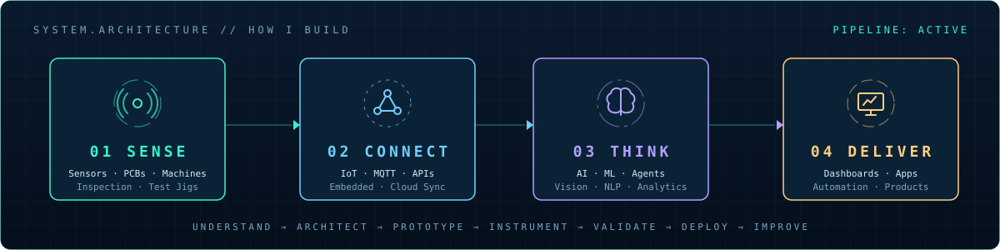
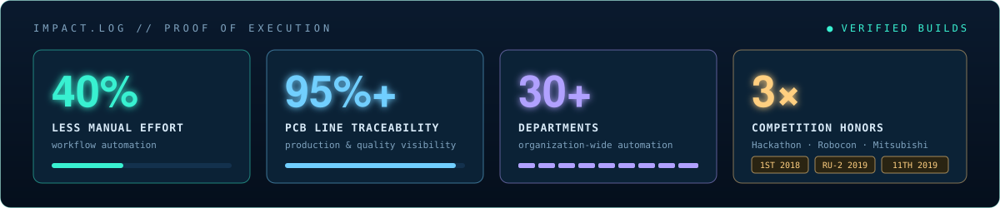
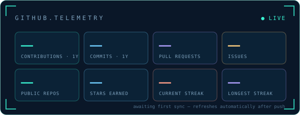
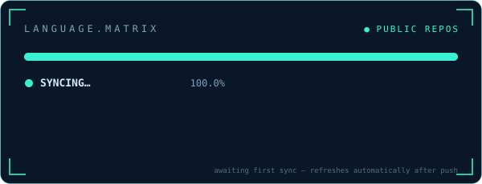
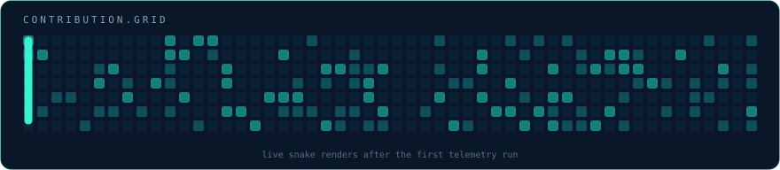

<!--
  GITHUB PROFILE // ALAYKUMAR PANDYA
  Deploy to: https://github.com/Alay291298/Alay291298
  IMPORTANT: keep the assets/, scripts/ and .github/ folders beside README.md.
  Every image in this README is a local, original SVG inside assets/ — no external image services.
  The telemetry cards in assets/generated/ are refreshed by .github/workflows/profile-telemetry.yml.
-->

<div align="center">

<a href="https://github.com/Alay291298"></a>

<br>

<a href="https://github.com/Alay291298?tab=repositories"></a>
<a href="https://revolutionautomationtech.com/"></a>
<a href="https://www.linkedin.com/in/alaykumarpandya/"></a>
<a href="https://medium.com/@alayluvpandya"></a>

<a href="https://www.youtube.com/@alayscreation2912"></a>
<a href="https://www.instagram.com/creator_del_futuro/"></a>
<a href="https://tools.revautotech.com/"></a>
<a href="mailto:albertpandya@gmail.com"></a>

<br><br>

<a href="https://www.linkedin.com/in/alaykumarpandya/"></a>

<br>

**`MS ECE @ NYIT`** &nbsp; ⟡ &nbsp; **`AI + INDUSTRIAL AUTOMATION`** &nbsp; ⟡ &nbsp; **`FULL STACK`** &nbsp; ⟡ &nbsp; **`HARDWARE / IoT`** &nbsp; ⟡ &nbsp; **`PUBLISHED AUTHOR`**

<br>

[**ABOUT**](#about) &nbsp; • &nbsp; [**ACHIEVEMENTS**](#achievements) &nbsp; • &nbsp; [**PROJECTS**](#projects) &nbsp; • &nbsp; [**TECH STACK**](#tech-stack) &nbsp; • &nbsp; [**EXPERIENCE**](#experience) &nbsp; • &nbsp; [**BOOKS & MEDIA**](#books-and-media) &nbsp; • &nbsp; [**CONNECT**](#connect)

</div>

---

<a id="about"></a>

## About

<sub>`01 // THE MIND BEHIND THE SYSTEMS`</sub>

<a href="https://revolutionautomationtech.com/"></a>

Hey, I'm **Alaykumar Pandya** (most people call me **Albert**) — an **Electrical & Computer Engineer, AI Automation Engineer, full-stack product builder, published author, and founder of [Revolution Automation Tech](https://revolutionautomationtech.com/)**.

My work lives where **physical engineering meets software intelligence**: industrial electronics, machine data, Python automation, applied AI, embedded/IoT systems, real-time dashboards, and products that people actually use.

I'm not interested in collecting technologies just to list them. I enjoy **finding the real problem, tracing it to its root cause, designing the complete system, and building a usable solution** — from prototype to integration and iteration.

<table>
<tr>
<td width="50%" valign="top">

**`🧠 HOW I THINK`**

Systems thinking · first-principles problem solving · cross-disciplinary reasoning · reliability · experimentation · user-centered product design

</td>
<td width="50%" valign="top">

**`⚙️ HOW I EXECUTE`**

Understand → architect → prototype → instrument → validate → deploy → improve

**I like owning the full journey**, from idea and electronics to APIs, interfaces, automation, and operations.

</td>
</tr>
</table>

<a href="https://github.com/Alay291298?tab=repositories"></a>

<details>
<summary><b>▶ OPEN FILE: whoami.yaml</b></summary>
<br>

```yaml
identity:
  name:      Alaykumar Pandya
  callsign:  Albert
  class:     Electrical & Computer Engineer
  base:      Stafford, Texas — Greater Houston
  company:   Revolution Automation Tech LLC   # Industrial Automation · AI · IoT

operating_modes:
  - 🤖 Robotics & Embedded Systems
  - 🧠 AI / ML / NLP Engineering
  - ⚡ PCB & Circuit Design
  - 🌐 Full-Stack Web & Mobile
  - 🎨 3D Environment Art (4+ years)
  - 📚 Published Author & Content Creator

side_quests:
  learning:  Sanskrit — reading, speaking, writing
  exploring: Where ancient knowledge meets artificial intelligence
```

</details>

<details>
<summary><b>▶ OPEN FILE: My engineering philosophy</b></summary>
<br>

> **“We are not replacing humans; we make work easier and stress-free.”**

I believe powerful technology should reduce repetitive work, prevent errors, improve visibility, and give people more time for judgment and creativity. A useful product is not the one with the most features; it is the one that solves the problem reliably and feels simple to use.

**The qualities I bring:** curiosity, persistence, research-minded thinking, practical creativity, cross-functional communication, engineering discipline, and willingness to learn a completely new stack when the problem requires it.

</details>

<a id="achievements"></a>

## Achievements

<sub>`02 // PROOF OF EXECUTION`</sub>

<a href="https://www.linkedin.com/in/alaykumarpandya/"></a>

<sub>Impact figures describe specific projects or work experiences and should not be interpreted as company-wide or universally measured results.</sub>

### 🏆 Competition honors & milestones

| Year | Recognition | What we built / explored |
|:--:|:--|:--|
| **2018** | 🥇 **1st Place — Gujarat Hackathon** | Smart traffic management concept for safer intersections and emergency-vehicle prioritization |
| **2019** | 🥉 **Second Runner-Up — ABU Robocon 2019** *(team recognition)* | Robot design, mechanism integration, control, and competitive problem-solving |
| **2019** | **11th Place — All-India Mitsubishi Electric Cup** | Automated induction-hardening solution for industrial tools |

### 📈 Engineering impact

- **40% less manual effort** — selected automation / workflow improvement work.
- **95%+ PCB line traceability** — production tracking and quality-process visibility.
- **30+ departments** — experience spanning wide organizational automation workflows.
- **Up to 25% energy savings** — reported result from an IoT-based Smart Office Automation project.
- **±0.3 °C precision** — temperature control circuit for an optic mount on a 24 VDC supply.
- **Founder — [Revolution Automation Tech](https://revolutionautomationtech.com/)** — building solutions across AI, industrial automation, software, and connected systems.

### 🌌 Beyond engineering

- **Published author** — *[The Evolution of Desires](#books-and-media)*, available in Kindle, paperback and hardcover on Amazon.
- **Book series in production** — *Sanatan Cosmos, Vol. 1: The Golden Womb*, with an interactive web reader.
- **4+ years of 3D environment art** — Blender, Maya and Unreal Engine.
- **AI-animated storytelling** — multi-scene Gujarati devotional productions on [YouTube](https://www.youtube.com/@alayscreation2912).

<details>
<summary><b>▶ OPEN FILE: Learning milestones & credentials</b></summary>
<br>

- **Generative AI: Prompt Engineering** — IBM (2024)
- **Machine Learning with Python** — LinkedIn Learning (2024)
- **Crash Course on Python** — Google (2022)
- **Python Automation and Testing** — LinkedIn Learning (2026)
- **IEEE Certificate of Participation** — IEEE Educational Activities (2023)

View public credentials on [LinkedIn](https://www.linkedin.com/in/alaykumarpandya/).

</details>

<a id="projects"></a>

## Projects

<sub>`03 // PRODUCTS, EXPERIMENTS & REAL-WORLD BUILDS`</sub>

### `FLAGSHIP // PRODUCTS I'M LAUNCHING`

<table>
<tr>
<td width="50%" valign="top">

#### 🗺️ RA Itinerary

A travel workspace for agencies, independent planners and personal travellers — itineraries, flights, stays and cars in one place, with subscription plans and an owner admin panel. Long-term vision: every official trip document (vouchers, tickets, payments) in one place.

`REACT` `TYPESCRIPT` `FIREBASE` `SAAS` · *in development*

</td>
<td width="50%" valign="top">

#### 🧰 [Workbench](https://tools.revautotech.com/)

My live tool gallery — a launchpad where I publish small, sharp HTML/React utilities, each at its own `/slug/`, with Google sign-in and a Firestore backend.

`NETLIFY` `FIREBASE` `REACT`

[**↗ LAUNCH WORKBENCH**](https://tools.revautotech.com/)

</td>
</tr>
<tr>
<td width="50%" valign="top">

#### 🎸 Fretless

A gesture-controlled guitar synthesizer. Real-time hand tracking drives a physically-modelled string synth — play in the air, no instrument required, then record and save performances.

`MEDIAPIPE` `WEB AUDIO` `KARPLUS-STRONG` `PWA`

</td>
<td width="50%" valign="top">

#### 🕰️ Trace — Life-Log App

Notes, voice memos, habits and mood check-ins on one precise, timestamped timeline — with smart tagging, streaks, search and export.

`REACT NATIVE` `EXPO` `MOBILE`

</td>
</tr>
</table>

### `PUBLIC // OPEN-SOURCE LAB`

<table>
<tr>
<td width="50%" valign="top">

#### 🧠 [ARViMe — Virtual Memory](https://github.com/Alay291298/ARVirutal-Memory)

Experiment exploring how AI and voice interaction can capture, organize, and help recall information.

`AI` `VOICE` `ACCESSIBILITY` `PROTOTYPE`

[**↗ SOURCE CODE**](https://github.com/Alay291298/ARVirutal-Memory) · [**↗ DEMO**](https://arvime.netlify.app/)

</td>
<td width="50%" valign="top">

#### 🏠 [Voice-Controlled Home Automation](https://github.com/Alay291298/Home-Automation)

Voice-controlled electronics and IoT integration for switching conventional appliances and exploring connected devices.

`HARDWARE` `IoT` `AUTOMATION`

[**↗ SOURCE CODE**](https://github.com/Alay291298/Home-Automation) · [**↗ VIDEO**](https://www.youtube.com/watch?v=4R3qSMQZbmw)

</td>
</tr>
<tr>
<td width="50%" valign="top">

#### 🤖 [Alienware AI](https://github.com/Alay291298/Alienware-AI)

Personal AI voice-assistant experiment investigating wake-word interactions and computer task automation.

`PYTHON` `VOICE ASSISTANT` `R&D`

[**↗ SOURCE CODE**](https://github.com/Alay291298/Alienware-AI)

</td>
<td width="50%" valign="top">

#### ✨ [Gemini Chat Interface](https://github.com/Alay291298/Gemini-Clone)

A conversational AI application prototype exploring language-model APIs and approachable frontend design.

`REACT` `GEN AI` `APIs`

[**↗ SOURCE CODE**](https://github.com/Alay291298/Gemini-Clone)

</td>
</tr>
<tr>
<td width="50%" valign="top">

#### 💡 [Li-Fi / Visible Light Communication](https://github.com/Alay291298/LiFi)

Electronics research and communication experiments involving data transmission through light.

`COMMUNICATIONS` `ELECTRONICS` `RESEARCH`

[**↗ PROJECT REPOSITORY**](https://github.com/Alay291298/LiFi)

</td>
<td width="50%" valign="top">

#### 📡 [MIMO Channel Analysis](https://github.com/Alay291298/MIMO)

Wireless communications research focused on spatial correlation and MIMO channel capacity.

`MATLAB` `WIRELESS` `SIGNAL PROCESSING`

[**↗ PROJECT REPOSITORY**](https://github.com/Alay291298/MIMO)

</td>
</tr>
</table>

<details>
<summary><b>▶ OPEN FILE: More public engineering research & code</b></summary>
<br>

| Repository | Focus |
|:--|:--|
| [Vehicular Network](https://github.com/Alay291298/Vehicular-Network) | Intelligent transport, route awareness, and safety-oriented network simulation |
| [PD Controller](https://github.com/Alay291298/PD-controller) | Control-system design and proportional–derivative analysis |
| [MATLAB Fundamentals](https://github.com/Alay291298/Matlab-with-all-basic-commands) | Engineering computation and MATLAB exercises |
| [All repositories](https://github.com/Alay291298?tab=repositories) | Explore further code, tests, and experiments |

</details>

### `PRODUCT STUDIO // PRIVATE SYSTEMS & ACTIVE BUILDS`

> The systems below include client projects, internal tooling, and work in progress. **Source code is intentionally not linked where private or client-owned.** A listed product does not imply a public release.

| System / product | What I'm engineering | Area |
|:--|:--|:--|
| **PCB Traceability & Intelligence** | Real-time line tracking, electronics testing records, AOI/inspection data, production dashboards | `INDUSTRIAL AI` `TRACEABILITY` |
| **Electronics Test & Inspection Tooling** | Raspberry Pi / Arduino jigs, inspection assistance, and repeatable test workflows | `EMBEDDED` `QA` |
| **RFID PCB Manufacturing Automation** | Automating RFID PCB production workflows | `PCB` `AUTOMATION` |
| **Hospitality Operations & POS** | Hotel check-in/out concepts, retail/POS workflows, operational dashboards and integrations | `HOSPITALITY TECH` |
| **Hotel Night-Audit Reporting Engine** | Pulls nightly audit ZIPs from Gmail, parses the CSVs, and auto-builds monthly KPI sheets (ADR, RevPAR, occupancy) | `APPS SCRIPT` `AUTOMATION` |
| **Multi-Property Payroll System** | Property-scoped roles, per-property FUTA/SUTA rates, meal-break rules, time-clock reset, Excel timesheet parser | `REACT` `FIREBASE` |
| **Fleet Operations SaaS** | White-label owner dashboard + driver mobile app architecture | `SAAS` `MOBILE` |
| **Client-Editable CMS Platforms** | Client-controlled sections, content, fonts, layouts, forms, admin dashboards and responsive experiences | `FULL STACK` `CMS` |
| **HPC / Academic Automation** | xCAT/Ansible workflows, Linux systems, and computing infrastructure support | `LINUX` `SYSTEMS` |

<details>
<summary><b>▶ OPEN FILE: AI · robotics · hardware lab</b></summary>
<br>

| Project | What it does | Stack |
|:--|:--|:--|
| 🎙️ **Conversational Recall Assistant** | Audio-to-text memory retrieval with planned sentiment & speaker ML | `PYTHON` `NLP` `SPEECH` |
| 🦾 **Autonomous Mecanum Robot** | DIY robot with line detection and a grabbing mechanism | `ROS` `C++` `EMBEDDED` |
| ☁️ **Custom IoT Platform** | Self-built replacement for IFTTT / Blynk | `IoT` `CLOUD` |
| 🌡️ **Optic-Mount Temperature Controller** | Precision control to **±0.3 °C** on 24 VDC | `ANALOG` `PCB` |
| 💼 **AI Job Application Bot** | Automates and personalizes job applications | `PYTHON` `LLMs` |
| 📨 **Bulk SMS Engine** | Template-driven bulk messaging with live API integration | `TWILIO` `JS` |

</details>

<details>
<summary><b>▶ OPEN FILE: RAP Lab — 3D printing & generative geometry</b></summary>
<br>

| Project | What it does | Stack |
|:--|:--|:--|
| 🏺 **Multi-Material Vase Generator** | Bézier curve editor, Three.js viewer, UV canvas, per-shell G-code & layer viewer for multi-colour FDM | `REACT` `THREE.JS` `G-CODE` |
| 🛠️ **Parametric Print Configurator** | Real-time lamps, vases, bowls and planters with procedural textures, print analysis & STL export | `THREE.JS` |
| 🔑 **Keychain → STL Batch Tool** | Upload a folder of images, strip backgrounds, get one printable STL each — with 3D preview & bulk download | `CANVAS` `STL` |
| 🌙 **Lithophane & Moon-Light Generators** | Custom lithophane / moon-light geometry and 3D-print workflow experiments | `STL` `3D` |
| 🔷 **ProtoForge Labs** | Scroll-reactive Three.js site + 3D printing configurator | `THREE.JS` `WEB` |

</details>

<details open>
<summary><b>▶ OPEN FILE: Selected client & business platforms</b></summary>
<br>

| Platform | Contribution / engineering focus | Website |
|:--|:--|:--|
| **Revolution Automation Tech** | Company digital platform, smart-automation solutions, and a full SEO rebuild with static prerendering | [↗ EXPLORE](https://revolutionautomationtech.com/) |
| **Yoon Engineering** | Aviation parts-search portal — 30+ vendor searches, Firestore cursor pagination, bulk parallel uploads, auth | [↗ LIVE SITE](https://yoon-engineering.com/) |
| **Kumar Consultancy** | Full-stack site, service flows, admin tooling, Supabase, and email integrations | [↗ LIVE SITE](https://kumarconsultancy.net/) |
| **E&IH Services** | Production React site for an industrial-hygiene & environmental consulting firm, with structured data & SEO | [↗ LIVE SITE](https://eihservice.com/) |
| **Vihaan Hospitality** | Hospitality website with a Firebase admin portal for logo, properties & contact info | [↗ LIVE SITE](https://vihaanhospitality.com/) |
| **Global Sweets & Namkeen Festo** | Responsive exhibition platform and content workflows | [↗ LIVE SITE](https://gsnf.in/) |
| **Rose & Petals** | Premium e-commerce visuals, product options, and Wix customization | *Client work* |
| **Miracara Skincare** | Shopify storefront and payment integration workflows | *Client work* |
| **Dave & Dave Travel Planner** | Responsive travel site and editable web platform features | *Client work* |
| **Buildx 3D** | Digital product and web-design explorations | *Selected project* |

</details>

<a id="tech-stack"></a>

## Tech Stack

<sub>`04 // CROSS-DOMAIN CAPABILITY`</sub>

<div align="center">

**LANGUAGES & ENGINEERING**

<a href="https://github.com/Alay291298?tab=repositories"></a>
<a href="https://github.com/Alay291298?tab=repositories"></a>
<a href="https://github.com/Alay291298?tab=repositories"></a>
<a href="https://github.com/Alay291298?tab=repositories"></a>
<a href="https://github.com/Alay291298?tab=repositories"></a>
<a href="https://github.com/Alay291298?tab=repositories"></a>
<a href="https://github.com/Alay291298?tab=repositories"></a>
<a href="https://github.com/Alay291298/MIMO"></a>

**AI / AUTOMATION**

<a href="https://github.com/Alay291298/ARVirutal-Memory"></a>
<a href="https://github.com/Alay291298/Alienware-AI"></a>
<a href="https://github.com/Alay291298?tab=repositories"></a>
<a href="https://github.com/Alay291298?tab=repositories"></a>
<a href="https://github.com/Alay291298?tab=repositories"></a>
<a href="https://github.com/Alay291298?tab=repositories"></a>
<a href="https://github.com/Alay291298?tab=repositories"></a>
<a href="https://github.com/Alay291298?tab=repositories"></a>

**WEB / MOBILE / DATA**

<a href="https://github.com/Alay291298/Gemini-Clone"></a>
<a href="https://github.com/Alay291298?tab=repositories"></a>
<a href="https://github.com/Alay291298?tab=repositories"></a>
<a href="https://github.com/Alay291298?tab=repositories"></a>
<a href="https://github.com/Alay291298?tab=repositories"></a>
<a href="https://github.com/Alay291298?tab=repositories"></a>
<a href="https://github.com/Alay291298?tab=repositories"></a>
<a href="https://github.com/Alay291298?tab=repositories"></a>
<a href="https://tools.revautotech.com/"></a>
<a href="https://github.com/Alay291298?tab=repositories"></a>

**CLOUD / SYSTEMS / AUTOMATION**

<a href="https://github.com/Alay291298?tab=repositories"></a>
<a href="https://github.com/Alay291298?tab=repositories"></a>
<a href="https://github.com/Alay291298?tab=repositories"></a>
<a href="https://tools.revautotech.com/"></a>
<a href="https://github.com/Alay291298?tab=repositories"></a>
<a href="https://github.com/Alay291298?tab=repositories"></a>
<a href="https://github.com/Alay291298?tab=repositories"></a>
<a href="https://github.com/Alay291298?tab=repositories"></a>
<a href="https://github.com/Alay291298?tab=repositories"></a>

**HARDWARE / ROBOTICS / MAKER LAB**

<a href="https://github.com/Alay291298/Home-Automation"></a>
<a href="https://github.com/Alay291298/PD-controller"></a>
<a href="https://github.com/Alay291298/Home-Automation"></a>
<a href="https://github.com/Alay291298/Home-Automation"></a>
<a href="https://github.com/Alay291298?tab=repositories"></a>
<a href="https://github.com/Alay291298?tab=repositories"></a>
<a href="https://github.com/Alay291298/LiFi"></a>
<a href="https://tools.revautotech.com/"></a>

**3D WORLDS & GRAPHICS**

<a href="https://www.youtube.com/@alayscreation2912"></a>
<a href="https://www.youtube.com/@alayscreation2912"></a>
<a href="https://www.youtube.com/@alayscreation2912"></a>
<a href="https://tools.revautotech.com/"></a>

</div>

<details>
<summary><b>▶ OPEN FILE: What these tools help me solve</b></summary>
<br>

| Engineering layer | Example problems |
|:--|:--|
| **Industrial intelligence** | PCB data collection, traceability, defect analysis, operational reporting |
| **AI & agents** | Intelligent assistance, repetitive task automation, multimodal and LLM-driven workflows |
| **IoT & control** | Device interfaces, sensors, communication, physical-world automation |
| **Web products** | Full-stack business apps, admin systems, customer experience, responsive UIs |
| **Infrastructure** | Linux, HPC, deployments, pipelines, integration reliability |
| **Fabrication** | Rapid prototyping, 3D-print utilities, custom hardware parts |

</details>

<details>
<summary><b>▶ OPEN FILE: Full capability matrix</b></summary>
<br>

| Domain | Core skills |
|:--|:--|
| 🧠 **Artificial intelligence** | NLP · CNNs · GANs · reinforcement learning · KNN · decision trees · clustering · prompt engineering |
| 🤖 **Robotics** | ROS · autonomous navigation · line detection · mecanum drive · grabbing mechanisms · mechanical design |
| ⚡ **Electrical / hardware** | PCB design (Altium, Eagle) · precision temperature control · microcontrollers · IoT · RFID manufacturing automation |
| 🌐 **Full-stack** | React · TypeScript · Vite · Tailwind · Firebase (Auth / Firestore / Storage) · SSR prerendering · PWAs · React Native / Expo |
| 🎮 **3D & graphics** | Blender · Maya · Unreal Engine · Three.js · procedural geometry · STL & G-code generation |
| 🔁 **Automation** | Google Apps Script · Gmail/Sheets pipelines · Twilio APIs · business workflow automation |
| 📈 **SEO & web performance** | Technical SEO audits · structured data · sitemap & indexing strategy · accessibility |
| 🎬 **Generative media** | AI video production · character-consistency prompting · multi-scene script pipelines |
| 🧭 **UX research** | LMS / UX research · user-centered product design |

</details>

<a id="experience"></a>

## Experience

<sub>`05 // ENGINEER → SYSTEMS BUILDER → FOUNDER`</sub>

```text
  ELECTRICAL ENGINEERING / CONTROLS
                 │
                 ├──── ROBOTICS, IoT, COMMUNICATIONS
                 │
                 ▼
  M.S. ELECTRICAL & COMPUTER ENGINEERING
                 │
                 ├──── QUALITY, TEST & INDUSTRIAL AUTOMATION
                 ├──── LINUX, COMPUTING & SYSTEMS INTEGRATION
                 ├──── AI + DATA + APPLIED SOFTWARE
                 │
                 ▼
  REVOLUTION AUTOMATION TECH
        BUILDING HUMAN-CENTERED INTELLIGENCE
```

- 🎓 **M.S., Electrical & Computer Engineering** — New York Institute of Technology (2024) · focus on AI, ML & robotics
- 🎓 **B.E., Electrical Engineering** — Gujarat Technological University (2021)
- 🏭 **Electrical Quality & Automation** — manufacturing, electronics, test and traceability work at RJ Electronic Assemblies
- 🧑‍💻 **AI & Automation Engineering** — projects associated with Virtual Labs
- 🖥️ **Academic Technology & Automation** — systems and technical support at NYIT
- 🚀 **Founder, [Revolution Automation Tech](https://revolutionautomationtech.com/)** — cross-industry engineering and intelligent digital products

<a id="books-and-media"></a>

## Books & Media

<sub>`06 // IDEAS BEYOND THE CODE`</sub>

<table>
<tr>
<td width="50%" valign="top">

#### 🧬 [The Evolution of Desires](https://www.amazon.com/s?k=The+Evolution+of+Desires+Alaykumar+Pandya)

*A Journey Through Species and Thoughts*

> *“From the first cell to artificial intelligence, the journey of life is the journey of desire.”*

Published in **Kindle, paperback and hardcover**, with a geo-routing share page that sends readers in 22 regions to their local Amazon store.

<a href="https://www.amazon.com/s?k=The+Evolution+of+Desires+Alaykumar+Pandya"></a>

</td>
<td width="50%" valign="top">

#### 🌌 Sanatan Cosmos — Vol. 1

*The Golden Womb: Birth of the Cosmos*

A book series on cosmology through the lens of Sanatan Dharma — produced as a print-quality hardback edition and an **interactive web reader** with page-turn effects and audiobook narration.

`WEASYPRINT` `PUPPETEER` `SPEECH SYNTHESIS` · *in production*

</td>
</tr>
<tr>
<td width="50%" valign="top">

#### 🎬 AI-Animated Storytelling

- 🪔 **Kuber No Bhavya Jamanvaar** — 29-scene Gujarati devotional comedy
- 📜 **Kuber — Part 1: The Divine Log** — 18-scene dramatic devotional short
- 🕉️ **Bhagavad Gita Anime Comic** — all 18 chapters reimagined
- 🧩 Custom prompt decks & character-lock systems for consistent AI video

<a href="https://www.youtube.com/@alayscreation2912"></a>

</td>
<td width="50%" valign="top">

#### ✍️ Writing & Behind the Scenes

Essays on AI, engineering and ideas on **Medium**; builds, renders and behind-the-scenes on **Instagram** at `@creator_del_futuro`.

<a href="https://medium.com/@alayluvpandya"></a>
<a href="https://www.instagram.com/creator_del_futuro/"></a>

</td>
</tr>
</table>

<a id="now"></a>

## Now Building

<sub>`07 // CURRENT R&D RADAR`</sub>

```yaml
mission: "Engineer intelligence into practical, human-centered products"

active_focus:
  - Applied AI agents & end-to-end automation
  - Industrial electronics, inspection & traceability
  - Full-stack platforms with powerful client editing
  - Travel, hospitality & operational software
  - IoT, embedded prototypes & maker utilities

open_to:
  - Engineering and product collaboration
  - Open-source R&D and robotics / IoT builds
  - AI integrations and practical automation challenges
  - Meaningful technical partnerships

principle: "Make complicated technology genuinely useful."
```

**Roadmap**

- [x] Found an automation & AI company
- [x] Publish a book
- [x] Ship production platforms for real clients
- [ ] 🚀 Launch **RA Itinerary** publicly (web + mobile)
- [ ] 🎸 Release **Fretless** as a public PWA
- [ ] 🕰️ Ship **Trace** to the app stores
- [ ] 🌌 Complete **Sanatan Cosmos** Volume 1
- [ ] 🕉️ Read, speak and write **Sanskrit** fluently

<a id="github-activity"></a>

## GitHub Activity

<sub>`08 // LIVE DEVELOPMENT SIGNALS`</sub>

<div align="center">

<a href="https://github.com/Alay291298"></a>
<a href="https://github.com/Alay291298?tab=repositories"></a>

<a href="https://github.com/Alay291298"></a>

<a href="https://github.com/Alay291298"></a>

<sub>Telemetry is generated daily inside this repository by a GitHub Action and covers public activity. It is not an assessment of engineering ability.</sub>

</div>

<a id="connect"></a>

## Connect

<sub>`09 // LET'S BUILD SOMETHING USEFUL`</sub>

Have a demanding engineering problem, a product idea, or a collaboration that crosses software and hardware? I'm interested in conversations where **real-world usefulness matters more than buzzwords**.

<div align="center">

<a href="https://www.linkedin.com/in/alaykumarpandya/"></a>
<a href="https://revolutionautomationtech.com/"></a>
<a href="https://github.com/Alay291298?tab=repositories"></a>
<a href="https://medium.com/@alayluvpandya"></a>

<a href="https://www.youtube.com/@alayscreation2912"></a>
<a href="https://www.instagram.com/creator_del_futuro/"></a>
<a href="https://tools.revautotech.com/"></a>
<a href="mailto:albertpandya@gmail.com"></a>

<br><br>

<a href="#about"></a>

<sub>Made for GitHub · original SVG visuals · cross-disciplinary engineering · updated October 2026</sub>

</div>
